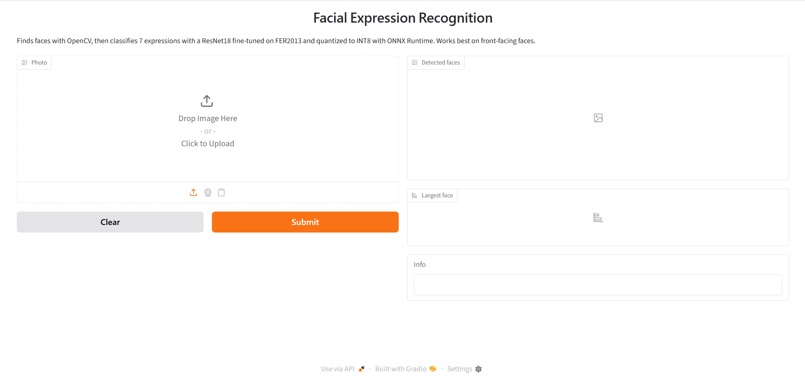

# სახის გამომეტყველების ამოცნობა (FER2013)

სისტემა ფოტოზე პოულობს სახეებს და თითოეულისთვის ამოიცნობს 7 გამომეტყველებიდან ერთ-ერთს: **Angry, Disgust, Fear, Happy, Sad, Surprise, Neutral**. მოდელი არის ImageNet-ზე წინასწარ დატრენინგებული ResNet18, რომელიც fine-tuning-ით მოვარგე FER2013-ს, შემდეგ კი ONNX Runtime-ით INT8 quantization გავუკეთე, რომ CPU-ზე სწრაფად იმუშაოს.

| | შედეგი |
|---|---|
| ტესტ accuracy (PrivateTest, 3 589 სურათი) | **68.5%** (INT8 მოდელი: 68.4%) |
| მოდელის ზომა | 44.8 MB → **11.3 MB** (INT8) |
| დრო ერთ სახეზე (CPU, 4 thread) | 68.5 ms → **3.0 ms** (INT8) |

- ექსპერიმენტები, გადაწყვეტილებები და შედეგები: **[REPORT.md](REPORT.md)**
- ტრენინგის ყველა გაშვება: [W&B რეპორტი](https://api.wandb.ai/links/adzid23-free-university-of-tbilisi-/lmcrzjhc)
- დატრენინგებული მოდელები: [Release v1.0](https://github.com/dzidz1/Freeuni_ML_Facial_Expression_Recognition/releases/tag/v1.0)



## დემო აპლიკაცია

საჭიროა **Python 3.13**.

**1. რეპოზიტორია და გარემო**

```bash
git clone https://github.com/dzidz1/Freeuni_ML_Facial_Expression_Recognition.git
cd Freeuni_ML_Facial_Expression_Recognition
python3.13 -m venv .venv          # Windows: py -3.13 -m venv .venv
source .venv/bin/activate         # Windows: .venv\Scripts\activate
pip install -r requirements.txt
```

Linux-ზე `requirements.txt`-მდე CPU-ს torch დააყენეთ, თორემ pip რამდენიმე GB CUDA ბიბლიოთეკას ჩამოტვირთავს:

```bash
pip install torch==2.11.0 torchvision==0.26.0 --index-url https://download.pytorch.org/whl/cpu
```

**2. მოდელების ჩამოტვირთვა** `weights/` საქაღალდეში:

```bash
mkdir -p weights
BASE=https://github.com/dzidz1/Freeuni_ML_Facial_Expression_Recognition/releases/download/v1.0
curl -L -o weights/ResNet18-pretrained.pth $BASE/ResNet18-pretrained.pth
curl -L -o weights/resnet18_fer_int8.onnx $BASE/resnet18_fer_int8.onnx
```

Windows PowerShell:

```powershell
mkdir weights
$base = "https://github.com/dzidz1/Freeuni_ML_Facial_Expression_Recognition/releases/download/v1.0"
Invoke-WebRequest "$base/ResNet18-pretrained.pth" -OutFile weights\ResNet18-pretrained.pth
Invoke-WebRequest "$base/resnet18_fer_int8.onnx" -OutFile weights\resnet18_fer_int8.onnx
```

ფაილების SHA256 ჯამები [Release-ის გვერდზეა](https://github.com/dzidz1/Freeuni_ML_Facial_Expression_Recognition/releases/tag/v1.0).

**3. გაშვება**

```bash
python app.py
```

გახსენით http://127.0.0.1:7860, ატვირთეთ ფოტო ან გადაიღეთ ვებკამერით. აპლიკაცია ყველა ნაპოვნ სახეს ჩარჩოთი მონიშნავს და ემოციას დააწერს, ყველაზე დიდი სახისთვის კი 7-ვე ემოციის ალბათობას აჩვენებს. საუკეთესოდ წინიდან გადაღებულ სახეებზე მუშაობს.

მოდელის შემოწმება ბრძანების ხაზიდანაც შეიძლება, უკვე ამოჭრილ სახეზე:

```bash
python inference.py path/to/face.jpg
```

## ტრენინგისა და ექსპერიმენტების გამეორება

| ნოუთბუქი | რას აკეთებს | სად ეშვება |
|---|---|---|
| `01_data_and_baseline.ipynb` | მონაცემების ანალიზი, sanity check-ები, SimpleCNN baseline | Colab (GPU) |
| `02_deeper_cnn.ipynb` | DeeperCNN, რეგულარიზაცია, augmentation | Colab (GPU) |
| `03_resnet.ipynb` | ResNet ნულიდან, learning rate scheduler | Colab (GPU) |
| `04_transfer_learning.ipynb` | ResNet18 (ImageNet): frozen / partial / სრული fine-tuning, ტესტ შეფასება; ინახავს `ResNet18-pretrained.pth`-ს | Colab (GPU) |
| `05_optimization.ipynb` | ONNX ექსპორტი, denormal-ების გავლენა, static INT8 კვანტიზაცია, შედარება | ლოკალურად (CPU) |

**Colab (01–04).** თითოეული ნოუთბუქის თავში "Open in Colab" ღილაკია. Runtime: **T4 GPU**. Colab-ის Secrets-ში საჭიროა ორი გასაღები, ჩართული "Notebook access"-ით:

- `KAGGLE_API_TOKEN`: https://www.kaggle.com/settings/api → Generate New Token. ასევე უნდა მიიღოთ [კონკურსის](https://www.kaggle.com/c/challenges-in-representation-learning-facial-expression-recognition-challenge) წესები.
- `WANDB_API_KEY`: https://wandb.ai/authorize

ნოუთბუქ 04-ში seed ფიქსირებულია (42); GPU-ზე შედეგები მაინც შეიძლება ოდნავ განსხვავდებოდეს.

**ლოკალურად (05).** საჭიროა `weights/ResNet18-pretrained.pth` (ზემოთ, ნაბიჯი 2) და მონაცემები `data/` საქაღალდეში:

```bash
export KAGGLE_API_TOKEN="your-token"         # PowerShell: $env:KAGGLE_API_TOKEN = "your-token"
kaggle competitions download -c challenges-in-representation-learning-facial-expression-recognition-challenge -p data
unzip data/challenges-in-representation-learning-facial-expression-recognition-challenge.zip -d data
# PowerShell: Expand-Archive data\challenges-in-representation-learning-facial-expression-recognition-challenge.zip -DestinationPath data
jupyter notebook 05_optimization.ipynb
```

ნოუთბუქი ქმნის `weights/resnet18_fer_int8.onnx`-ს, რომელსაც `app.py` იყენებს.

## პროექტის სტრუქტურა

```
├── 01_data_and_baseline.ipynb
├── 02_deeper_cnn.ipynb
├── 03_resnet.ipynb
├── 04_transfer_learning.ipynb   # საბოლოო მოდელის ტრენინგი და ტესტ შეფასება
├── 05_optimization.ipynb        # ONNX და INT8 კვანტიზაცია, სიჩქარისა და ზომის შედარება
├── inference.py                 # მოდელი და preprocessing; მას იყენებს app.py და 05
├── app.py                       # Gradio დემო: სახის პოვნა + ემოციის კლასიფიკაცია
├── requirements.txt             # დაფიქსირებული ვერსიები
├── assets/                      # confusion matrix, დემოს სქრინშოტები
├── weights/                     # მოდელები (git-ში არ ინახება; Release-დან)
├── data/                        # FER2013 (git-ში არ ინახება; Kaggle-დან)
├── README.md
└── REPORT.md                    # ტექნიკური ანგარიში
```

## პროექტის იდეა

პროექტი დაიწყო თავისუფალი უნივერსიტეტის მანქანური სწავლების კურსის Kaggle-ის დავალებად (ნოუთბუქები 01–04). ამ დავალებისთვის დავამატე ოპტიმიზაცია, დემო აპლიკაცია, მოდელების Release, reproducible environment და ტექნიკური ანგარიში. დეტალები [REPORT.md](REPORT.md)-ის მე-8 ნაწილშია.