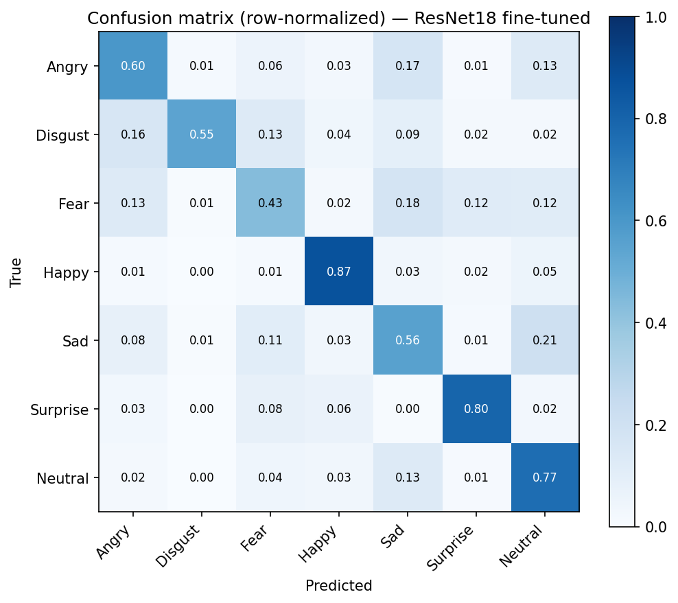

# ტექნიკური ანგარიში: სახის გამომეტყველების ამოცნობა (FER2013)

> **მოკლედ:** ImageNet-ზე წინასწარ დატრენინგებული ResNet18, fine-tuning-ით მორგებული FER2013-ზე, ტესტ სეტზე **68.5%** accuracy-ს აჩვენებს. Static INT8 კვანტიზაციის შემდეგ accuracy **68.4%**-ია, ფაილი 3.9-ჯერ პატარაა (11.3 MB), ერთი სახის დამუშავებას კი CPU-ზე **3.0 ms** სჭირდება. Gradio აპლიკაცია ფოტოზე პოულობს სახეებს და თითოეულს ემოციას უწერს.

ყველა ტრენინგის გაშვება ჩაწერილია W&B-ში: [W&B რეპორტი](https://api.wandb.ai/links/adzid23-free-university-of-tbilisi-/lmcrzjhc). გაშვების ინსტრუქცია [README.md](README.md)-შია.

---

## 1. რა პრობლემას წყვეტს პროექტი

სისტემა იღებს ჩვეულებრივ ფოტოს, პოულობს მასზე სახეებს და თითოეულისთვის ამოიცნობს 7 გამომეტყველებიდან ერთ-ერთს: Angry, Disgust, Fear, Happy, Sad, Surprise, Neutral. ამოცანა ორი ნაწილისგან შედგება: **ლოკალიზაცია** (სად არის სახე) და **კლასიფიკაცია** (რა გამომეტყველებაა).

ასეთი სისტემა გამოიყენება, მაგალითად, მომხმარებლის რეაქციების ანალიზში (UX კვლევა, რეკლამის ტესტირება), ადაპტურ ინტერფეისებსა და ხელმისაწვდომობის ინსტრუმენტებში. მნიშვნელოვანი შეზღუდვა: მოდელი ცნობს სახის **გამომეტყველებას** და არა იმას, რასაც ადამიანი რეალურად გრძნობს.

## 2. რატომ ეს მონაცემები, მოდელი და მიდგომა

### მონაცემები

FER2013 (`icml_face_data.csv`, Kaggle-ის კონკურსი *Challenges in Representation Learning*): 35 887 grayscale სახე, 48×48 ზომის, ოფიციალური დაყოფით Training / PublicTest / PrivateTest (28 709 / 3 589 / 3 589). ეს ნაკრები შევარჩიე, რადგან:

- ლეიბლირებული ტესტ სეტი აქვს და დაყოფა ჩემით არ მჭირდებოდა;
- შედეგები საჯარო ბენჩმარკებთან შედარებადია;
- პატარა სურათების გამო ტრენინგი უფასო Colab GPU-ზე ეტევა, რაც დავალების პირობაა.

PublicTest-ს ვიყენებ ვალიდაციად (მოდელისა და checkpoint-ის შესარჩევად), PrivateTest-ს კი მხოლოდ საბოლოო შეფასებისთვის.

ნაკრების მთავარი სირთულეები:

- **კლასების დისბალანსი:** მთელ ნაკრებში Disgust-ის მხოლოდ 547 მაგალითია, Happy-ის კი 8 989 (დაახლოებით 16-ჯერ მეტი).
- **ხმაურიანი ლეიბლები:** კონკურსის ორგანიზატორების შეფასებით, ადამიანის accuracy ამ ნაკრებზე დაახლოებით 65 ± 5%-ია (Goodfellow et al., 2013).

### მოდელი

ექსპერიმენტები მარტივიდან რთულისკენ ავაგე, რომ ყოველი ცვლილების ეფექტი ცალკე დამენახა (ნაწილი 3). საბოლოოდ ავირჩიე ImageNet-ზე წინასწარ დატრენინგებული **ResNet18 სრული fine-tuning-ით**: ვალიდაციაზე საუკეთესო შედეგი მისცა და ამავდროულად საკმარისად პატარაა (11.2M პარამეტრი), რომ CPU-ზე სწრაფად იმუშაოს.

### მონაცემების მორგება წინასწარ დატრენინგებულ მოდელზე

ResNet18 ImageNet-ის ფერად სურათებზეა გაწვრთნილი. ამიტომ თითო 48×48 სურათს ვადიდებ 96×96-მდე, ერთ არხს 3-ჯერ ვიმეორებ (grayscale → "RGB") და ImageNet-ის საშუალოთი და სტანდარტული გადახრით ვანორმალებ. 96×96 კომპრომისია: ResNet18 სურათს 32-ჯერ ამცირებს, ამიტომ 48×48-ზე ბოლო feature map მხოლოდ 2×2 იქნებოდა, 96×96-ზე 3×3-ია, ხოლო 224×224 გამოთვლას დაახლოებით 5-ჯერ გააძვირებდა.

### Checkpoint-ის შერჩევა

საუკეთესო ეპოქას ვალიდაციის **loss-ით** ვირჩევ და არა accuracy-ით. საბოლოო მოდელში val loss მე-14 ეპოქის შემდეგ იზრდება, val accuracy კი 21-ე ეპოქამდე იმატებს: მოდელი მეტ პასუხს სწორად სცემს, მაგრამ შეცდომებშიც უფრო თავდაჯერებული ხდება. Loss-ით შერჩეული მოდელი უკეთ კალიბრირებულ ალბათობებს იძლევა, რაც დემოსთვის მნიშვნელოვანია, რადგან იქ ალბათობებს ვაჩვენებ. ფასი: ვალიდაციის accuracy 1.1 პუნქტით დაბალია (67.5% vs 68.6%).

### პრაქტიკული გამოყენება

აპლიკაციისთვის ავირჩიე static INT8 ONNX მოდელი (ნაწილი 3.5), სახის საპოვნელად კი OpenCV-ის Haar cascade: დამატებით მოდელის ფაილს არ საჭიროებს და CPU-ზე სწრაფად მუშაობს, თუმცა მხოლოდ წინიდან გადაღებულ სახეებს პოულობს.

## 3. ექსპერიმენტები და შედეგები

ტრენინგი Colab-ის T4 GPU-ზე ჩატარდა: Adam ოპტიმიზატორი, batch 64, cross-entropy loss.

### 3.1 Sanity check-ები ტრენინგამდე

- **საწყისი loss:** გაუწვრთნელი მოდელი 7 კლასს თანაბრად უნდა ხვდებოდეს, ანუ loss ≈ −ln(1/7) = 1.946. მივიღე 1.94, ესე იგი output ფენა და loss სწორად არის შეერთებული (მაგალითად, ორმაგი softmax არ მაქვს).
- **ერთი batch-ის overfit:** 64 სურათზე accuracy-მ 40 ნაბიჯში 100%-ს მიაღწია, ანუ backprop და optimizer ნამდვილად სწავლობენ.

### 3.2 ექსპერიმენტების შედარება

სვეტების მნიშვნელობა:

- **ბოლო ეპოქის train / val** აჩვენებს, რამდენად აქვს მოდელს overfit;
- **Val (checkpoint)** არის val accuracy იმ ეპოქაზე, რომელიც ყველაზე დაბალი val loss-ით შეირჩა. სწორედ ეს მოდელი ინახება და ფასდება;
- **Val (პიკი)** არის მაქსიმალური val accuracy ნებისმიერ ეპოქაზე. კურსის პირველ ვერსიაში ეს რიცხვი იყო მითითებული (იხ. ნაწილი 4).

| # | ექსპერიმენტი | Train, ბოლო ეპოქა | Val, ბოლო ეპოქა | Val (checkpoint) | Val (პიკი) |
|---|---|---|---|---|---|
| 1 | SimpleCNN (2 conv), რეგულარიზაციის გარეშე | 98.5 | 51.4 | 52.6¹ | 53.2 |
| 2 | DeeperCNN (3 conv ბლოკი + BatchNorm), რეგულარიზაციის გარეშე | 97.5 | 54.9 | 56.4 | 59.1 |
| 3 | DeeperCNN, dropout 0.5 + weight decay 1e-4 | 62.7 | 54.8 | 55.8 | 56.6 |
| 4 | DeeperCNN, dropout 0.8 + weight decay 1e-2 | 53.6 | 52.0 | 53.8 | 54.9 |
| 5 | DeeperCNN, augmentation + dropout 0.3 | 63.2 | 62.7 | 63.1² | 63.2 |
| 6 | ResNet ნულიდან, dropout 0.3, augmentation-ის გარეშე | 91.5 | 50.9 | 57.1 | 57.2 |
| 7 | ResNet ნულიდან + augmentation | 67.0 | 63.3 | 62.4 | 63.3 |
| 8 | ResNet ნულიდან + augmentation + ReduceLROnPlateau | 75.6 | 66.7 | 66.0 | 66.7 |
| 9 | ResNet18 (ImageNet), frozen backbone, ტრენინგდება მხოლოდ head³ | 38.2 | 39.1 | 38.6 | 39.1 |
| 10 | ResNet18 (ImageNet), layer3 + layer4 გახსნილი³ | 78.6 | 66.0 | 65.8 | 66.4 |
| 11 | **ResNet18 (ImageNet), სრული fine-tuning** | 80.8 | 67.7 | **67.5** | 68.6 |

¹ ნოუთბუქ 01-ში checkpoint არ ინახება; შედარებისთვის ნაჩვენებია ყველაზე დაბალი val loss-ის ეპოქა.
² ბოლო, 50-ე ეპოქაზეც ჯერ კიდევ უმჯობესდებოდა, ანუ მეტ ეპოქას შეიძლება კიდევ მოეგო.
³ 9 და 10 ნოუთბუქ 04-ის პირველი გაშვებიდანაა (seed-ის გარეშე), 11 კი seed=42-ით განმეორებული გაშვებიდან.

### 3.3 რა დავასკვენი

- **Bias–variance (1–4).** რეგულარიზაციის გარეშე მოდელი train set-ს იზეპირებს: 97–98% train-ზე და 51–55% ვალიდაციაზე. SimpleCNN-ის val loss მე-6 ეპოქის შემდეგ 1.29-დან 4.12-მდე იზრდება. Dropout 0.5 + weight decay 1e-4 train/val სხვაობას 43 პუნქტიდან 8-მდე ამცირებს, dropout 0.8 + weight decay 1e-2 კი მოდელს იმდენად ზღუდავს, რომ train set-საც ვეღარ სწავლობს (underfit). Train accuracy რეგულარიზაციის ზრდასთან ერთად მონოტონურად ეცემა.
- **Augmentation სჯობს dropout-ს (3 vs 5).** Dropout-მა სხვაობა train accuracy-ის დაწევით შეამცირა, augmentation-მა კი val accuracy გაზარდა (55.8 → 63.1) და სხვაობაც თითქმის ნულამდე დაიყვანა.
- **ნულიდან ტრენინგს მონაცემები ზღუდავს და არა არქიტექტურა (5 vs 7).** ResNet-მა augmentation-ით DeeperCNN-ს მხოლოდ გაუტოლდა (~63%). LR scheduler-მა (8) კიდევ 3.6 პუნქტი მოიგო (62.4 → 66.0): learning rate-ის ყოველი განახევრების შემდეგ ვალიდაცია ოდნავ უმჯობესდებოდა.
- **Transfer learning (9–11).** Frozen ImageNet feature-ები 48×48 grayscale სახეებს კარგად ვერ ჰყოფს (38.6%). Frozen-დან სრულ fine-tuning-მდე სხვაობიდან (28.9 პუნქტი) 94% მხოლოდ ბოლო ორი ბლოკის (layer3, layer4) გახსნამ დააბრუნა, ადრეულმა ფენებმა კი 1.7 პუნქტი მოამატა. ანუ ამოცანისთვის სპეციფიკურ სამუშაოს ბოლო ფენები აკეთებს, ადრეული ფენები (კიდეები, ტექსტურები) უფრო ზოგადია. სრულმა fine-tuning-მა პირველივე ეპოქის შემდეგ ~56% მისცა, რაც უკვე სრულად დატრენინგებულ SimpleCNN-ზე მეტია.

### 3.4 საბოლოო შეფასება ტესტ სეტზე

მოდელი 11, PrivateTest (3 589 სურათი, რომელიც მოდელის შერჩევაში არ მონაწილეობდა): **accuracy 68.5%**, macro F1 0.658. ტესტის შედეგი ვალიდაციისაზე (67.5%) დაბალი არ არის, ესე იგი მოდელი ვალიდაციაზე არ "მოვარგე".

| ემოცია | Precision | Recall | F1 | სურათები |
|---|---|---|---|---|
| Angry | 0.646 | 0.599 | 0.622 | 491 |
| Disgust | 0.667 | 0.545 | 0.600 | 55 |
| Fear | 0.573 | 0.434 | 0.494 | 528 |
| Happy | 0.893 | 0.870 | 0.881 | 879 |
| Sad | 0.532 | 0.557 | 0.544 | 594 |
| Surprise | 0.772 | 0.796 | 0.783 | 416 |
| Neutral | 0.613 | 0.765 | 0.681 | 626 |

**შეცდომების ანალიზი:**

- **Fear ყველაზე რთულია** (recall 0.43). შეცდომები რამდენიმე კლასზე იფანტება: Sad 0.18, Angry 0.13, Surprise 0.12, Neutral 0.12. შიშის გამომეტყველებას საერთო ნიშნები აქვს რამდენიმე ემოციასთან: გაფართოებული თვალები და ღია პირი, როგორც Surprise-ს, აწეული და შეკრული წარბები, როგორც Sad-ს.
- **Sad → Neutral (0.21) და Angry → Sad (0.17).** ეს ნაზი გამომეტყველებებია; 48×48 ზომაზე ტუჩის კუთხეებისა და წარბების მცირე განსხვავებები იკარგება.
- **Disgust:** ტესტში მხოლოდ 55 სურათია, ამიტომ ერთი სურათი recall-ს 1.8 პუნქტით ცვლის და ეს შეფასება არასტაბილურია. ყველაზე ხშირად Angry-სთან ერევა (0.16).
- **Happy ყველაზე მარტივია** (0.87): ღიმილი დიდი და ძალიან გამორჩეული ნიშანია.

**გამეორებადობა:** ნოუთბუქ 04-ის პირველმა გაშვებამ (seed-ის გარეშე) ტესტზე 69.5% მისცა, seed-ით განმეორებულმა 68.5%. ანუ ერთი და იმავე კონფიგურაციის გაშვებებს შორის ~1 პუნქტის სხვაობა ნორმალურია და ექსპერიმენტებს შორის 1 პუნქტზე ნაკლებ განსხვავებას დასკვნისთვის არ ვიყენებ.

### 3.5 ოპტიმიზაცია (`05_optimization.ipynb`)

**პირობები:** Intel-ის 12-ე თაობის Core პროცესორი (Alder Lake, `Family 6 Model 154`), 12 ლოგიკური ბირთვი; ყველა ვარიანტი 4 thread-ს იყენებს; batch 1, როგორც აპლიკაციაში. დრო არის 200 გაშვების მედიანა 20 "გასახურებელი" გაშვების შემდეგ; accuracy დათვლილია მთელ PrivateTest-ზე, თითო სურათით.

| ვარიანტი | ზომა | ტესტ accuracy | დრო (მედიანა) | p95 | სიჩქარე PyTorch-თან |
|---|---|---|---|---|---|
| PyTorch FP32 | 44.8 MB | 68.5% | 68.5 ms | 68.9 ms | 1.0× |
| ONNX Runtime FP32 | 44.8 MB | 68.5% | 57.5 ms | 57.8 ms | 1.2× |
| ONNX Runtime FP32, denormal-ები → 0 | 44.8 MB | 68.5% | 18.1 ms | 18.3 ms | 3.8× |
| **ONNX Runtime INT8 (static)** | **11.3 MB** | **68.4%** | **3.0 ms** | 3.1 ms | **22.8×** |

**შემოწმებები:**

- PyTorch-ის accuracy CPU-ზე, `inference.preprocess`-ით, 0.6851-ია, ზუსტად იგივე, რაც ნოუთბუქ 04-ში GPU-ზე. ესე იგი აპლიკაციის preprocessing ტრენინგისას იდენტურია.
- ONNX-ის logit-ები PyTorch-ისას ემთხვევა; accuracy და კლასების recall ორივეში ერთნაირია, ანუ ექსპორტს მოდელი არ შეუცვლია.

**INT8 კვანტიზაცია.** წონები და აქტივაციები 32-ბიტიანი float-ის ნაცვლად 8-ბიტიანი მთელი რიცხვებით ინახება. *Static* ნიშნავს, რომ აქტივაციების დიაპაზონი ერთხელ, წინასწარ იზომება 300 შემთხვევითი **სატრენინგო** სურათით (ტესტის სურათები კალიბრაციაში არ მონაწილეობს, რომ ტესტის შედეგი სამართლიანი დარჩეს). გამოვიყენე QDQ ფორმატი, per-channel წონები და `quant_pre_process`, რომელიც BatchNorm-ს წინა convolution-ში აერთიანებს. PyTorch-ის dynamic კვანტიზაცია არ გამოვიყენე: ის მხოლოდ `Linear` ფენებს ეხება, აქ კი ეს მხოლოდ 7-კლასიანი head-ია (11.2M-დან 3 591 პარამეტრი). CNN-ში გამოთვლის დიდი ნაწილი convolution-ებზე მოდის.

**შედეგი:** INT8 მოდელი 3.9-ჯერ პატარაა, accuracy მხოლოდ 0.1 პუნქტით დაბალია და FP32-ის პასუხს ტესტის 98.7%-ზე ემთხვევა (3 589-დან ~47 სურათი განსხვავდება). კლასების recall მაქსიმუმ 1.8 პუნქტით შეიცვალა (Disgust: 55-დან 1 სურათი).

**Denormal რიცხვების აღმოჩენა.** INT8-ის 22.8-ჯერ აჩქარება საეჭვო იყო, რადგან INT8 ჩვეულებრივ 2–4-ჯერ აჩქარებს. FP32-ის 68 ms ასეთი მცირე მოდელისთვის (96×96-ზე ~0.33 მილიარდი გამრავლება-შეკრება) მოსალოდნელზე გაცილებით ნელი იყო. ჰიპოთეზა: ზოგიერთ შუალედურ მნიშვნელობაში ჩნდება **denormal** რიცხვები (~1.2·10⁻³⁸-ზე ნაკლები), რომლებსაც პროცესორი ნელი გზით ამუშავებს; მთელ რიცხვებს ეს პრობლემა არ აქვს. შემოწმება: ONNX Runtime-ის `session.set_denormal_as_zero` პარამეტრმა FP32-ის დრო 57.5-დან 18.1 ms-მდე შეამცირა (3.2×), accuracy-ის ცვლილების გარეშე. ესე იგი "22.8×"-ის დიდი ნაწილი კვანტიზაციის დამსახურება არ იყო. სამართლიან შედარებაში INT8 denormal-ებგასუფთავებულ FP32-ზე **6.0-ჯერ** სწრაფია. ესეც ტიპურზე მეტია, რაც, სავარაუდოდ, იმით აიხსნება, რომ ამ თაობის პროცესორებს 8-ბიტიანი გამოთვლებისთვის AVX-VNNI ინსტრუქციები აქვს. Denormal-ების გაუსუფთავებლად FP32-ის დრო გაშვებებს შორის იცვლებოდა (ONNX FP32: 48 → 57 ms), გასუფთავებული FP32 და INT8 კი სტაბილური იყო.

**დასკვნა:** აპლიკაცია იყენებს INT8 მოდელს, denormal-ების გასუფთავებით.

### 3.6 დემო აპლიკაცია (`app.py`)

Pipeline: ფოტო → grayscale → Haar cascade-ით სახეების პოვნა (48 px-ზე პატარას ვაიგნორებ) → ჩარჩოს 10%-ით გაფართოება, რომ შუბლი და ნიკაპი მოხვდეს, როგორც FER2013-ში → ამოჭრა → შემცირება 48×48-მდე (იგივე დეტალიზაცია, რაც სატრენინგო სურათებს აქვს) → ტრენინგის იდენტური preprocessing (`inference.preprocess`) → INT8 ONNX მოდელი → softmax. თითოეულ სახეს ჩარჩო და ემოცია ეწერება, უდიდესი სახისთვის 7-ვე ალბათობა ჩანს. სტარტზე ერთი "გასახურებელი" გაშვება ხდება, რომ პირველი მოთხოვნა ნელი არ იყოს.

ხარისხობრივი შემოწმება 5 ფოტოზე (angry, happy, sad, surprise, fear): ხუთივე სწორად ამოიცნო; ყველაზე დაბალი დარწმუნებით Sad (40%, მეორე ადგილზე Angry 26%), რაც ტესტ სეტზე Sad-ის შედარებით სუსტ შედეგს შეესაბამება. ეს გაზვიადებული, პოზირებული გამომეტყველებებია, FER2013-ის ბუნებრივ ფოტოებზე გაცილებით მარტივი, ამიტომ ეს შემოწმება მხოლოდ იმას ადასტურებს, რომ სისტემა ახალ სურათებზე მუშაობს; accuracy-ის შეფასება ტესტ სეტის შედეგებია.

## 4. რა პრობლემებს წავაწყდი და როგორ გადავჭერი

1. **Overfitting** baseline-ში: გადავჭერი რეგულარიზაციით და, უფრო ეფექტურად, augmentation-ით (3.3).
2. **ნულიდან ტრენინგის ზღვარი (~66%):** გადავედი transfer learning-ზე და ImageNet-ის მოდელი 48×48 grayscale სურათებს მოვარგე (ნაწილი 2).
3. **ვალიდაციის რიცხვი არასწორ checkpoint-ს ეკუთვნოდა.** `run_experiment` ინახავდა ყველაზე დაბალი val loss-ის ეპოქის წონებს, მაგრამ W&B-ში `best_val_acc`-ად ნებისმიერი ეპოქის მაქსიმალურ accuracy-ს წერდა, რომელიც სხვა ეპოქიდან შეიძლებოდა ყოფილიყო. ამიტომ კურსის ვერსიაში მითითებული 69.1% ტესტირებული მოდელის რიცხვი არ იყო (მისი val accuracy 67.6% იყო). ნოუთბუქ 04-ში ახლა ორივე ინახება, `best_val_acc` (checkpoint) და `peak_val_acc`; ცხრილი 3.2 ორივეს აჩვენებს, 01–03-ისთვის ტრენინგის ლოგებიდან გამოთვლილს. მოდელების რიგი და დასკვნები არ შეცვლილა.
4. **წონები შენახული არ იყო და seed ფიქსირებული არ იყო.** საუკეთესო მოდელი მხოლოდ Colab-ის მეხსიერებაში არსებობდა. დავამატე `set_seed(42)`, `torch.save` და W&B model artifact, მოდელი თავიდან დავატრენინგე და GitHub Release-ში SHA256 ჯამებით ავტვირთე.
5. **ბიბლიოთეკების თავსებადობა.**
   - OpenCV 5-ში (Colab-ის ვერსია) Haar cascade ამოღებულია, ამიტომ აპლიკაციისთვის `opencv-python-headless==4.14.0.94` დავაფიქსირე.
   - `onnx` 1.23 ფაილებს IR ვერსია 14-ით წერს, onnxruntime 1.30 კი მაქსიმუმ 13-ს კითხულობს, რის გამოც კვანტიზაცია ვარდებოდა. დავაფიქსირე `onnx==1.22.0`.
   - Kaggle-ის ახალმა CLI-მ ძველი `KAGGLE_USERNAME` / `KAGGLE_KEY` აღარ მიიღო; გადავედი `KAGGLE_API_TOKEN`-ზე.

   ყველა ვერსია `requirements.txt`-შია დაფიქსირებული.
6. **Denormal რიცხვები** ანელებდა FP32 მოდელს და INT8-ის მოგებას აზვიადებდა (3.5).
7. **რეალური ფოტოები FER2013-ს არ ჰგავს** (დიდი, ფერადი, სახე სადმე ფოტოზე): დავამატე სახის პოვნა, ჩარჩოს გაფართოება და ჯერ 48×48-მდე შემცირება. მთელი preprocessing ერთ ფუნქციაშია (`inference.preprocess`), რომელსაც აპლიკაციაც და ნოუთბუქ 05-იც იყენებს, და ნოუთბუქ 05-ში ამ ფუნქციით მიღებული accuracy ნოუთბუქ 04-ს ემთხვევა. ასე ტრენინგსა და გამოყენებას შორის preprocessing ვერ განსხვავდება.

## 5. ძლიერი და სუსტი მხარეები

**ძლიერი მხარეები**

- ექსპერიმენტები სისტემურია: ერთდროულად ერთი ცვლილება, თითოეულს თავისი მიზეზი აქვს და ყველა W&B-შია ჩაწერილი.
- Sanity check-ები ტრენინგამდე; ტესტ სეტი მხოლოდ საბოლოო შეფასებისთვის; INT8-ის კალიბრაცია მხოლოდ სატრენინგო მონაცემებით.
- გამეორებადობა: seed, დაფიქსირებული ვერსიები, წონები Release-ში SHA256-ით და W&B artifact-ად.
- ერთი preprocessing ფუნქცია ტრენინგისა და გამოყენებისთვის, შემოწმებული accuracy-ის დამთხვევით.
- ოპტიმიზაცია ფრთხილად არის გაზომილი (warm-up, მედიანა და p95, ერთნაირი thread-ები, შემოწმებები), მოულოდნელი შედეგი კი გამოვიკვლიე და ისე არ დავწერე.
- სწრაფი და მსუბუქია: 3 ms ერთ სახეზე, 11 MB მოდელი, მხოლოდ CPU.

**სუსტი მხარეები**

- Accuracy 68.5%-ია; Fear (0.43) და Sad (0.56) სუსტია. ნაწილობრივ ეს FER2013-ის ხმაურიანი ლეიბლების ბრალია (ადამიანის accuracy ~65%).
- კლასების დისბალანსს პირდაპირ არ ვუმკლავდები (class weights არ გამომიყენებია); Disgust-ის შეფასება ცოტა მაგალითის გამო არასტაბილურია.
- თითო კონფიგურაცია ერთხელ გავუშვი, ამიტომ 1 პუნქტზე ნაკლები განსხვავებები სანდო არ არის.
- FER2013-ის 48×48 grayscale სურათები რეალურ ფოტოებს არ ჰგავს; რეალურ ფოტოებზე accuracy გაზომილი არ მაქვს, მხოლოდ ხარისხობრივად შევამოწმე.
- Haar cascade მხოლოდ წინიდან გადაღებულ სახეებს პოულობს: გვერდით მობრუნებულ, დახრილ ან ცუდად განათებულ სახეებს შეიძლება ვერ იპოვოს.
- სიჩქარე ერთ ლეპტოპზეა გაზომილი; სხვა პროცესორზე, განსაკუთრებით AVX-VNNI-ის გარეშე, INT8-ის მოგება ნაკლები იქნება.
- ნოუთბუქებში 01–03 ძველი `run_experiment` დარჩა (თავიდან არ გამიშვია); მათი რიცხვები ცხრილში ლოგებიდან არის გამოთვლილი.

## 6. რას გავაუმჯობესებდი დამატებითი დროითა და რესურსით

- **დისბალანსი:** class-weighted loss, focal loss ან Disgust-ის oversampling.
- **ხმაურიანი ლეიბლები და რეგულარიზაცია:** label smoothing, mixup / cutmix, random erasing.
- **Test-time augmentation:** სურათისა და მისი სარკისებური ასლის პროგნოზების გასაშუალოება.
- **სტატისტიკური სანდოობა:** რამდენიმე seed თითო კონფიგურაციაზე, საშუალო და გაბნევით.
- **უფრო ძლიერი მოდელები:** ResNet34/50, EfficientNet, ConvNeXt-Tiny, უფრო დიდი input ზომა ან რამდენიმე მოდელის ensemble, თუ გამოთვლითი რესურსი იქნება.
- **სახის პოვნა:** DNN დეტექტორი (მაგ., OpenCV YuNet) და სახის გასწორება (alignment), ტრენინგიც გასწორებულ სახეებზე.
- **კალიბრაცია:** temperature scaling, რომ ალბათობები უფრო სანდო იყოს.
- **ოპტიმიზაცია:** quantization-aware training, თუ INT8-ის დანაკარგი გაიზრდება; სიჩქარის გაზომვა სხვადასხვა პროცესორზე.
- **გამოყენება:** აპლიკაციის განთავსება Hugging Face Spaces-ზე, რომ ბმულით ყველამ შეძლოს შემოწმება.

## 7. AI ინსტრუმენტების გამოყენება

*[შეავსეთ: გამოიყენეთ თუ არა AI ინსტრუმენტები კურსის ნაწილზე (ნოუთბუქები 01–04) და რისთვის.]*

ამ დავალების ნაწილზე გამოვიყენე Claude (Anthropic):

- **დაგეგმვა:** დავალების მოთხოვნები შევადარე არსებულ პროექტს და განვსაზღვრე, რა აკლდა (ოპტიმიზაცია, დემო, მოდელის ფაილები, ინსტრუქციები, ანგარიში).
- **კოდის მიმოხილვა:** ნოუთბუქ 04-ის მიმოხილვისას გამოჩნდა, რომ წონები არ ინახებოდა და `best_val_acc` სხვა ეპოქას ეკუთვნოდა.
- **კოდის მონახაზი:** `inference.py`, `05_optimization.ipynb`, `app.py` და `requirements.txt`-ის პირველი ვერსიები.
- **პრობლემების მოგვარება:** Kaggle-ის ავტორიზაცია, ბიბლიოთეკების თავსებადობა (OpenCV 5, onnx IR ვერსია) და denormal-ების შემოწმების იდეა, როცა 22.8× აჩქარება საეჭვოდ გამოიყურებოდა.
- **დოკუმენტაცია:** ამ ანგარიშისა და README-ს მონახაზი.

**როგორ გადავამოწმე:**

- ყველა კოდი ჩემით გავუშვი და ხაზ-ხაზ გავიაზრე;
- შედეგები დამოუკიდებლად შევამოწმე: პარამეტრების რაოდენობა (11 180 103), accuracy-ის დამთხვევა ნოუთბუქ 04-თან (0.6851), PyTorch-ისა და ONNX-ის logit-ების დამთხვევა, Release-ის ფაილების SHA256;
- აპლიკაცია ახალ ფოტოებზე გამოვცადე;
- ანგარიშის ყველა რიცხვი ნოუთბუქების output-ებიდან და ლოგებიდანაა.

## 8. პროექტის წარმოშობა და რა დაემატა ამ დავალებისთვის

პროექტი დაიწყო თავისუფალი უნივერსიტეტის მანქანური სწავლების კურსის Kaggle-ის დავალებად: ნოუთბუქები 01–04, ექსპერიმენტები 1–11 და W&B რეპორტი. ამ დავალებისთვის დავამატე:

- ნოუთბუქ 04-ში: seed, წონების შენახვა (ფაილი და W&B artifact), `best_val_acc`-ის შეცდომის გასწორება და ხელახალი ტრენინგი;
- `inference.py`: მოდელისა და preprocessing-ის საერთო კოდი;
- `05_optimization.ipynb`: ONNX ექსპორტი, denormal-ების ანალიზი, static INT8 კვანტიზაცია და შედარება;
- `app.py`: Gradio აპლიკაცია სახის პოვნითა და კლასიფიკაციით;
- `requirements.txt` შემოწმებული, დაფიქსირებული ვერსიებით;
- GitHub Release v1.0 წონებით და SHA256 ჯამებით;
- `README.md` და ეს ანგარიში.